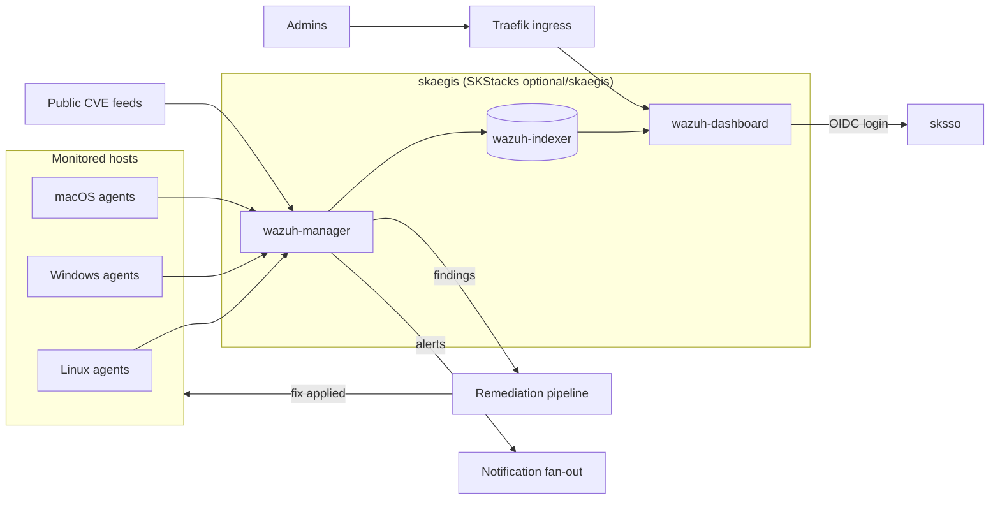

# skaegis-skworld-io

**The GitHub Pages site for skaegis, served at https://skaegis.skworld.io.** skaegis is the Detect pillar of the SKWorld security suite (Defend sksec, Detect skaegis, Remediate skpatch): self-hosted, continuous CVE detection across Linux, Windows and macOS.
**Maturity tier:** T0 (static marketing site, no cryptographic surface; see [CRYPTOGRAPHY_STANDARD](https://github.com/smilinTux/sk-standards/blob/main/standards/CRYPTOGRAPHY_STANDARD.md)) · **Version phase:** Incubating v3 (product is in design; this site describes the plan).

This repo is the website only. It contains no product code.

## Component map



The interactive version, with motion and a dark/light toggle, is at
[diagrams/skaegis.architecture.html](diagrams/skaegis.architecture.html) and linked from the live
site's [Diagrams section](https://skaegis.skworld.io/#diagrams). The topology comes only from the
mermaid in [smilinTux/skaegis](https://github.com/smilinTux/skaegis).

## Diagrams

All three diagrams are authored as [Archify](https://github.com/tt-a1i/archify) JSON and built to
standalone, self-contained HTML. CI (`archify`) rebuilds them and fails a pull request if the
committed HTML is stale.

| Diagram | JSON source | Built HTML |
|---|---|---|
| Component map (architecture) | `diagrams/skaegis.architecture.json` | `diagrams/skaegis.architecture.html` |
| Data flow (agents and feeds to findings, dashboard, pipeline) | `diagrams/skaegis.dataflow.json` | `diagrams/skaegis.dataflow.html` |
| Closed loop (detect to verified close) | `diagrams/skaegis.workflow.json` | `diagrams/skaegis.workflow.html` |

## Docs viewer

`docs.html` renders `smilinTux/skaegis`'s `docs/*.md` live from the GitHub Contents API, with
`docs-manifest.json` as a committed offline fallback and a daily self-healing GitHub Action
(`.github/workflows/refresh-docs-manifest.yml`) to keep it in sync. `llms.txt` gives a plain-text
summary for language-model crawlers.

## Quickstart
```
python3 -m http.server 8000   # serve the site locally
open http://localhost:8000    # no build step, plain HTML and CSS
git push origin main          # GitHub Pages publishes from the repo root
```

## Honest claims (read this)
- skaegis detects **known, published CVEs** on hosts that run an enrolled agent. It does not find unknown flaws and does not cover unenrolled hosts.
- The site never claims a system is unhackable, 100% secure or quantum-anything. It says what the product does and labels the product as in design.
- Tier contents and pricing are plans, not commitments. The site says so next to the tier cards.

## Docs
- [SOP.md](./SOP.md): architecture, build, test, release, troubleshooting.
- [AGENTS.md](./AGENTS.md) · [SECURITY.md](./SECURITY.md) · [CONTRIBUTING.md](./CONTRIBUTING.md) · [CODE_OF_CONDUCT.md](./CODE_OF_CONDUCT.md) · [CHANGELOG.md](./CHANGELOG.md)

## Related projects / See also
- ⬆️ **Depends on:** [sk-standards](https://github.com/smilinTux/sk-standards): doc, disclosure and writing-style rules this site follows.
- ↔️ **Sibling:** [skoffroad-skworld-io](https://github.com/smilinTux/skoffroad-skworld-io): another plain-static SKWorld Pages site this one mirrors.
- ↔️ **Sibling:** [sksec](https://github.com/smilinTux/sksec) and [skpatch](https://github.com/smilinTux/skpatch): the Defend and Remediate pillars of the suite.
- 📐 **Standards:** [sk-standards](https://github.com/smilinTux/sk-standards).

*License: MIT.*
