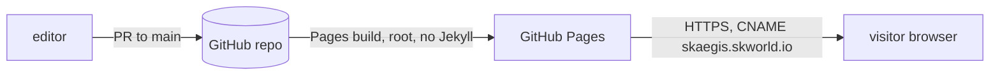

# skaegis-skworld-io: Standard Operating Procedures

Static marketing site for skAegis, published by GitHub Pages at https://skaegis.skworld.io. Edited by hand, no build step.

## 1. Overview
Owns the landing page and its assets. Does NOT own product code, pricing decisions, or product docs; the page must match the current product plan and say so where it is only a plan.

## 2. Architecture

No server, no forms, no analytics, no third-party scripts. The only network fetch is the page's own files.

**Start here:**
- `index.html`: the whole landing page (hero, suite, loop, features, tiers, FAQ).
- `styles.css`: all styling, dark theme, CSS variables at the top.
- `CNAME`: must contain exactly `skaegis.skworld.io`.

## 3. Build
No build. `.nojekyll` makes Pages serve files as-is.

## 4. Test
```bash
python3 -m http.server 8000      # eyeball at 320px and desktop width
grep -rnP '[\x{2013}\x{2014}]' . --include='*.html' --include='*.md' --include='*.css'   # must print nothing
python3 <path-to-sk-standards>/scripts/docs_check.py --repo .
```

## 5. Release / Deploy
Merge to `main`; Pages publishes the repo root. Settings: Pages source = `main` / root, custom domain `skaegis.skworld.io`, enforce HTTPS. DNS: CNAME `skaegis` to the org Pages host. Rollback: revert the merge commit. Add a `CHANGELOG.md` entry per release.

## 6. Configuration / Usage
Copy edits go in `index.html`. Keep every claim inside what the product plan supports; see the honest-claims list in the README.

## 7. API / Reference
None. Static files only.

## 8. Troubleshooting
| Symptom | Check |
|---|---|
| Custom domain reverts to github.io | `CNAME` file present and exact; domain set in Pages settings |
| HTTPS cert pending | DNS CNAME resolves to the Pages host; wait, then enable Enforce HTTPS |
| Styles missing | Paths are relative (`styles.css`); `.nojekyll` present |

## 9. Maturity-tier + Version reference
T0 (no cryptographic surface) · Incubating v3 · SemVer `0.x` · CRYPTOGRAPHY_STANDARD: not a crypto component, no key material handled.

<!-- docs-evidence
verified: 2026-11-11
checks:
  - name: CNAME is exact
    run: test "$(cat CNAME)" = "skaegis.skworld.io"
  - name: landing page present
    run: test -f index.html && grep -q 'continuous shield' index.html
  - name: no em or en dashes in site and docs
    run: test -z "$(grep -lP '[\x{2013}\x{2014}]' index.html styles.css *.md)"
  - name: no overclaim words in the page
    run: test -z "$(grep -iE 'unhackable|quantum-proof|100% secure|unbreakable' index.html)"
-->
